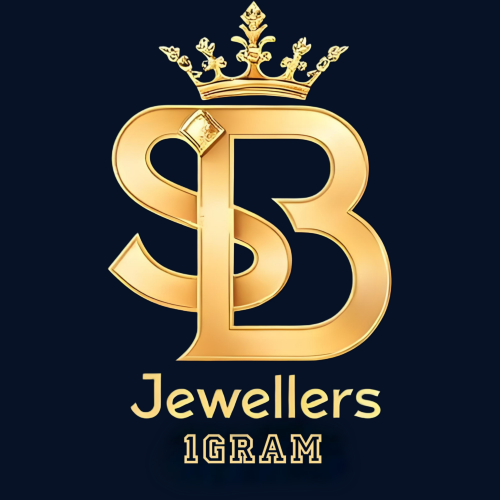

# SB Jewellers

### A little gold. A lot of elegance.

**Sri Balaji Imitation Jewellery · Rajahmundry · Since 2015**

1 Gram Rold Gold & CZ Jewellery  
Everyday favourites. Celebration pieces. Beautiful choices for every budget.

[Explore Our Website](https://loki0406.github.io/sb_jewellers_1gram/) · [Visit Our Shop](https://maps.app.goo.gl/DdZCBB8Nn4Cmtzv76) · [WhatsApp Enquiries](https://wa.me/919032399091)

---

## Jewellery with a little more character

From a delicate daily-wear pendant to a statement temple necklace, SB Jewellers brings together traditional charm and contemporary styles. Explore our collection online, then visit our Rajahmundry shop to find your favourite.

**Budget-friendly retail & wholesale prices available.**

## Explore the collections

| For Boys | For Girls |
| --- | --- |
| Chains — rope, box and slim link styles | Necklaces — chokers, long harams and temple sets |
| Pendants — religious motifs and geometric CZ cuts | Pendant sets — daily-wear short chains with CZ charms |
| Kadas & bracelets — heavy bands and link styles | Mangalsutras — black bead chains with CZ main pieces |
| Rings — broad statement designs and CZ grids | Bangles & bracelets — stone-studded sets and mesh charms |
| Studs & hoops — single-stone micro CZ earrings | Earrings — jhumkas, hanging drops and daily studs |
| | Rings — adjustable floral and solitaire styles |

## Browse. Discover. Visit.

- Browse all collections or use the boys’ and girls’ filters.
- Open a collection to explore its styles and enquire on WhatsApp.
- Use **Visit Our Shop** for directions.
- Ask us about current designs, availability, retail enquiries and wholesale purchases.

Shipping available · Sunday orders accepted

## Stay connected

[Instagram — @sbjewellers_1gram](https://www.instagram.com/sbjewellers_1gram/)  
[YouTube — Sri Balaji Jewellers](https://youtube.com/@sri_balaji_jewellers)  
[YouTube — SB Jewellers](https://youtube.com/@sbjewellers1gram)  
[WhatsApp Channel](https://whatsapp.com/channel/0029VbBhHVE002T3JmzdR71e)

**Call:** [+91 90323 99091](tel:+919032399091) / [+91 97041 25649](tel:+919704125649)  
**Location:** Rajahmundry, Andhra Pradesh

## Behind the website

An ivory, burgundy and antique-gold catalogue built with HTML, CSS and JavaScript. Responsive layouts, collection filters and accessible dialogs make browsing simple across devices.

| File | Purpose |
| --- | --- |
| `index.html` | Website content and collection cards |
| `styles.css` | Visual design and responsive layouts |
| `catalogue.js` | Filters, collection dialogs and enquiry links |
| `images/catalogue/` | Optimised category images |
| `images/logo.png` | Shop logo |
| `images/visting_card_1.png` | Shop visiting card |

No installation or build step is required. GitHub Pages serves the repository root.

To update a collection, edit its card in `index.html` and matching details in `catalogue.js`. Replace category images using the existing filenames.

> Catalogue images are AI-created illustrations of jewellery types, not photographs of verified shop stock. Contact us or visit the shop to confirm current designs and availability.

---

**SB Jewellers · Your moments. Our little sparkle.**

